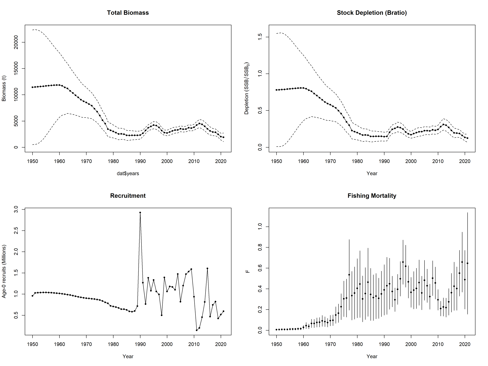

# Integrated Stock Assessment of Snappers using RTMB

## Overview
This repository contains a bespoke, fully integrated stock assessment model developed in **RTMB** (R for TMB) for the Snapper stock (*Lutjanus analis*). The model integrates three sources of data: historical catch, a fishery-dependent CPUE index, and length compositions. 

It was developed as a validation and modernization exercise, reimplementing a previously published SS3 assessment (Soares et al., 2025) into a highly flexible, open-source R framework.

**Reference Publication:** [Soares et al. (2025) - DOI: 10.1111/fme.70008](https://doi.org/10.1111/fme.70008)

## Model Structure
The model follows an age-structured, statistical catch-at-age approach adapted for data-limited and data-moderate scenarios:
- **Population Dynamics:** Exponential decay with Baranov catch equations.
- **Recruitment:** Three configurable scenarios: Flat (constant), Beverton-Holt, and Ricker. Recruitment deviations are estimated as random effects with a fixed log-normal standard deviation.
- **Fishing Mortality:** Estimated annually (72 parameters).
- **Selectivity:** Length-based logistic curve, estimating `SL50` and `SL95`.
- **Likelihoods:** 
  - Log-normal for catch and CPUE index.
  - Multinomial for length compositions.

## Key Results & Validation
The model successfully converged, demonstrating high agreement with the original SS3 output:
- **Estimated Selectivity (SL50):** `39.3 cm` (SS3 matched: `39.0 cm`).
- **Depletion:** The model reveals a severe stock decline, reaching a `Bratio` (SSB/SSB_virgin) of ~0.14, categorized as overfished.
- **Model Selection:** AIC comparison showed that the Flat, Beverton-Holt and Ricker models performed similarly. Beverton-Holt was retained for management reference points due to biological plausibility.
- **Reference Points (Beverton-Holt):** Successfully derived \(F_{MSY}\) = `0.184` and \(SSB_{MSY}\) = `2435.9` tons. These closely match the SS3 outputs (\(F_{MSY}\) = 0.140, \(SSB_{MSY}\) = 2205.9), validating the RTMB implementation.

**SS3 Baseline & Reproducibility:** 
The original SS3 input files (`starter.ss`, `controlfile.ctl`, `datafile.dat`, `forecast.ss`) used for comparison are available in the `ss3_baseline/` folder.

## Development Journey
This repository documents the step-by-step construction of the model through 11 versions, showing the debugging process of a bespoke assessment:
1. **V1-V5:** Catch-only model, scale corrections, and addition of CPUE index.
2. **V6-V8:** Implementation of length compositions.
3. **V9-V10:** Fixing stability issues, initializing the 1950 population, and **fixing a conceptual bug (using maturity parameters L50/L95 instead of fishery selectivity Sel50/Selpeak)**.
4. **V11:** Implementation of multi-scenario recruitment (Beverton-Holt and Ricker), dynamic Amax extraction, and reporting necessary data for external calculation of MSY-based reference points.

## How to Run
1. Clone this repository.
2. Ensure you have the `RTMB` package installed.
3. Place data files in the `data/` folder.
4. Run `source("snappers_assessment_2021.R")`.

## Citation
If you use this code or framework in your research, please cite the original assessment:
> Soares, A. et al. (2025). *20 Years Later: Updated Stock Assessment of Snappers in Northeast Brazil Using an Integrated Stock Assessment Framework.* Fisheries Management and Ecology. https://doi.org/10.1111/fme.70008

## Author
**Andrey Soares**
*Ph.D. in Fisheries Science | Stock Assessment & Data-Limited Methods*